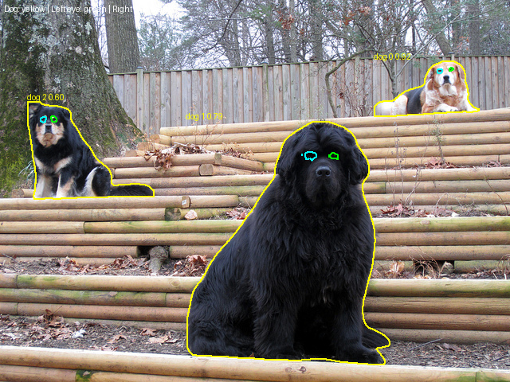
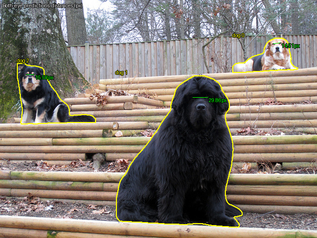

# Inference

利用 Animal Segmentation 模型 + Eye Localization 模型 + Eye Segmentation 模型，進行眼睛距離計算。

## 執行方式

從專案根目錄執行，使用 `--image-id` 指定 COCO 圖片：

```bash
uv run python -m run.inference --image-id 000000081766
```

`--image-id` 須與圖片檔名（不含 `.jpg`）完全一致；省略時預設為 `000000081766`。程式直接讀取 `data/coco/val2017/{image_id}.jpg`。

## 可選圖片 ID

以下為本專案篩選出的 29 張「至少包含 2 隻非 crowd 狗」圖片，來源為 `outputs/selection/two_or_more_dogs.csv`。

> `000000057760`、`000000071226`、`000000081766`、`000000089880`、`000000090003`
>
> `000000107226`、`000000125405`、`000000129756`、`000000143961`、`000000149568`
>
> `000000182805`、`000000193162`、`000000209613`、`000000236784`、`000000246454`
>
> `000000262938`、`000000269113`、`000000289702`、`000000318238`、`000000355240`
>
> `000000366884`、`000000372819`、`000000401991`、`000000427034`、`000000432553`
>
> `000000464522`、`000000512836`、`000000547502`、`000000562561`


## 輸出

位置：`outputs/inference/{圖片檔名}/`。

| 輸出 | 內容 |
|---|---|
| `overlay.png` | 動物與眼睛的輪廓 |
| `both_eyes_distance.png` | 左右眼預測座標皆有效之同狗的雙眼距離 |
| `right_eyes_distance.png` | 右眼預測座標有效之兩隻狗的右眼距離 |
| `predictions.json`、`distances.json` | 預測座標、信心分數與像素距離 |

## 範例輸出：000000081766

```bash
uv run python -m run.inference --image-id 000000081766
```

使用 YOLO26x-seg → HRNet-w48 → SAM ViT-B，狗偵測信心門檻為 0.5，本圖偵測到 3 隻狗。狗的編號依模型輸出順序排列。

### 動物與眼睛分割

黃色為狗的輪廓，綠色為左眼，藍色為右眼。



### 同一隻狗的雙眼距離



- Dog 0：14.51 px
- Dog 1：29.86 px
- Dog 2：15.58 px

### 不同狗的右眼距離


- Dog 0 ↔ Dog 1：194.31 px
- Dog 0 ↔ Dog 2：501.75 px
- Dog 1 ↔ Dog 2：339.09 px

距離端點為 HRNet 預測座標，單位為原圖 pixel。目前僅檢查座標是否為有限值且位於原圖內，未驗證實際眼睛可見性，因此實際被遮擋的眼睛也可能產生距離。
